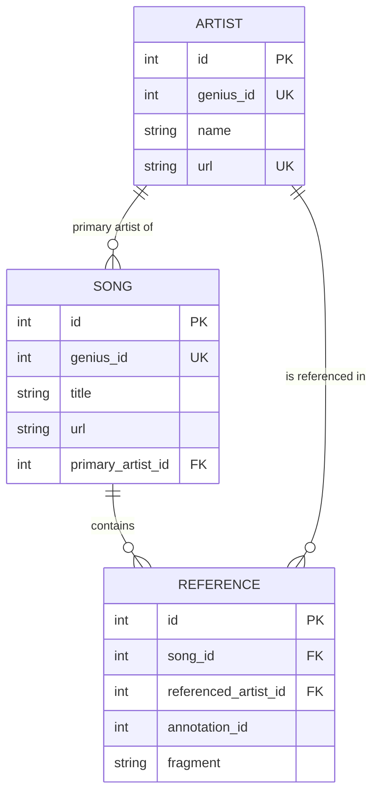

# genius-scraper

Build a **network of musicians referencing other musicians in their lyrics**, based on the
community annotations on [genius.com](https://genius.com).

## Idea

- Artists release songs, songs have lyrics.
- On Genius, users annotate lyric fragments to explain their meaning.
- Annotations often link to other artists (e.g. *"This line is a nod to Nas"*).
- Every such link is a directed edge **artist A → artist B**.

The scraper collects songs, their annotations and the artists referenced in them and stores
everything in a SQL database. The data can then be exported to graph tools
(NetworkX, Gephi, Neo4j, ...) for analysis.

## Architecture

```
CLI (cli.py) ──▶ Pipeline (pipeline.py) ──▶ GeniusClient (scraper/client.py) ──▶ Genius API
                     │        ▲
                     │        └── Reference extractor (scraper/extractor.py)
                     ▼
               Repository (db/) ──▶ SQL database (SQLite by default)
```

| Module                 | Responsibility                                               |
| ---------------------- | ------------------------------------------------------------ |
| `config.py`            | Loads settings from environment / `.env`                     |
| `scraper/client.py`    | Thin wrapper around the official Genius API                  |
| `scraper/extractor.py` | Finds artist links inside annotation bodies                  |
| `db/models.py`         | SQLAlchemy ORM models                                        |
| `db/session.py`        | Engine / session creation, table setup                       |
| `db/repository.py`     | Upsert helpers used by the pipeline                          |
| `pipeline.py`          | Orchestrates: artist → songs → annotations → references → DB |
| `cli.py`               | Command line entry point                                     |

## Data model



A network edge is `SONG.primary_artist → REFERENCE.referenced_artist`.

## Setup

Requires Python 3.11+.

```powershell
python -m venv .venv
.venv\Scripts\Activate.ps1
pip install -e ".[dev]"
copy .env.example .env   # then insert your Genius API token
```

Get an API access token at <https://genius.com/api-clients>.

## Usage

```powershell
genius-scraper init-db
genius-scraper scrape-artist "Kendrick Lamar" --max-songs 50
genius-scraper song-annotations 4589365 --max-songs 5
pytest
```

Both scraping commands create the database tables if needed and save discovered
song-to-artist annotation references to `DATABASE_URL`. `song-annotations` also
writes an HTML graph (by default, `graph.html`). Repeated scans do not duplicate
previously stored references. Completed songs are skipped on later runs, including
songs with no artist references; saved graph results are reused to continue a crawl.
Songs stored before scan tracking was added will be scanned once more to mark them
complete.

The default SQLite database is a local `genius.db` file in the directory where you
run the command. It does not need a server or manual startup. If you set
`DATABASE_URL` to PostgreSQL or another server database, that server must be running.

## Configuration

| Variable              | Default               | Description                          |
| --------------------- | --------------------- | ------------------------------------ |
| `GENIUS_ACCESS_TOKEN` | –                     | Genius API token (required)          |
| `DATABASE_URL`        | `sqlite:///genius.db` | Any SQLAlchemy URL (e.g. PostgreSQL) |
| `REQUEST_DELAY`       | `0.5`                 | Seconds between API requests         |

## Roadmap

- [x] Project skeleton
- [ ] Better reference extraction (plain-text artist name matching, song links → artist)
- [ ] Resolve referenced artists (slug → Genius ID / name)
- [ ] Recursive crawl (breadth-first over referenced artists)
- [ ] Export to GraphML / CSV
- [ ] Tests with recorded API responses

## Legal note

Respect the [Genius Terms of Service](https://genius.com/static/terms). This project uses the
official API, stores only metadata and short annotated fragments, and does **not** store full
lyrics.